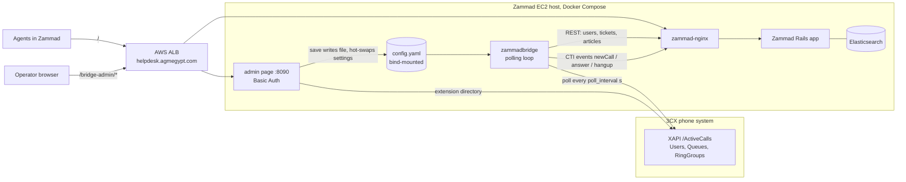

# Architecture

## Components

One Go binary, `zammadbridge`, built from `./cmd/main.go`. Inside it:

| Part | Files | Job |
|---|---|---|
| Start-up and flags | `cmd/main.go`, `config.go` | Reads `config.yaml`, sets up logging (`-f json\|plain`, `-v`, `--trace`), creates the bridge, starts the admin page in a goroutine, then runs the polling loop. |
| 3CX client | `brigde_3cx.go` (sic), `bridge_3cx_post20.go`, `bridge_3cx_pre20.go` | Logs in to 3CX. It tries the v20+ API first and falls back to the pre-v20 API when 3CX answers HTTP 404. On v20+ the AGM fork reads calls from the XAPI `/xapi/v1/ActiveCalls` endpoint, which lists every call on the system. It also reads users, queues and ring groups for the admin page. |
| Polling loop | `bridge.go` | Every `Bridge.poll_interval` seconds: fetch active calls, work out direction (inbound or outbound), agent and external number, and spot calls that have ended (no longer listed). On a 401/403 it logs in again; if that fails for two minutes, the process exits. |
| Zammad CTI events | `zammad.go` (`ZammadNewCall`, `ZammadAnswer`, `ZammadHangup`, `ZammadPost`) | Posts `newCall`, `answer` and `hangup` events to the CTI webhook URL in `Zammad.endpoint`. |
| Ticket auto-create (AGM) | `zammad.go`, `autocreate.go` | After a hangup, if `auto_create_ticket` is on and the call passes the direction and extension filters: look up or create the Zammad customer by external number, then create a ticket (or append to a recent open one, see de-duplication). |
| Admin page (AGM) | `admin.go` | HTTP server with Basic Auth. Shows and saves the auto-create settings, writes them to the config file and swaps them into the running bridge without a restart. |

## How they talk

1. **Bridge → 3CX (HTTPS, pull).** The bridge polls 3CX. On v20+ it gets a bearer token from `/connect/token` with the API client ID and secret, then calls `GET /xapi/v1/ActiveCalls`. The admin page also calls `/xapi/v1/Users`, `/xapi/v1/Queues` and `/xapi/v1/RingGroups` (cached for 5 minutes). Nothing in 3CX calls the bridge.
2. **Bridge → Zammad CTI webhook (HTTP POST).** One JSON event per call state change, sent to `Zammad.endpoint`. The secret is part of that URL.
3. **Bridge → Zammad REST API (HTTP, token auth).** Only when auto-create is on. Uses `Zammad.api_url` and `Zammad.api_token`:
   - `GET /api/v1/users/search` to find the customer by phone,
   - `POST /api/v1/users` to create one if missing (first name = number, last name `3CX`),
   - `GET /api/v1/tickets/search` to find a recent new/open ticket for the de-duplication window (needs Zammad's Elasticsearch index),
   - `POST /api/v1/ticket_articles` to append a repeat call, or `POST /api/v1/tickets` to create a ticket.
4. **Operator → admin page (HTTPS via the load balancer).** In production the AWS ALB sends requests for `/bridge-admin/*` on the helpdesk host to port 8090 on the Zammad EC2 host. The bridge serves the page under `Admin.base_path` (`/bridge-admin`), so the ALB does not rewrite the path.

In production the bridge runs in the same Docker Compose project as Zammad. It reaches Zammad by the Compose service name (`zammad-nginx`), not over the internet.

## Diagram

## External dependencies

| Dependency | Used for | What happens if it is down |
|---|---|---|
| AGM 3CX PBX (v20+, XAPI) | Source of all call data; extension directory for the admin page | No calls are seen. A 3CX login failure for two minutes stops the process; Docker restarts it (`restart: always`). |
| 3CX API client (Admin → Integrations → API) | Client ID and secret for the XAPI | 401/403 errors, then the process exits as above. TODO(owner): which 3CX admin account owns this API client, and who may rotate its secret? |
| Zammad (`helpdesk.agmegypt.com`, same Compose project) | CTI webhook and REST API | Events and tickets for that period are lost. The bridge logs the error and carries on; it does not queue or retry later. If the CTI `hangup` post fails, no ticket is created for that call either. |
| Zammad Elasticsearch | Ticket search for the de-duplication window | The search finds nothing, so every repeat call opens a new ticket. No error is raised (the miss is logged at debug level only). |
| Zammad custom ticket attribute named in `call_id_field` | Stores the 3CX call ID on the ticket | Not verified what Zammad does if the attribute is missing. TODO(owner): confirm the attribute named in the production `call_id_field` exists in Zammad (Admin → Objects). |
| AWS ALB, target group `zammad-bridge-admin-tg` | Operator access to the admin page | Admin page unreachable; call handling is not affected. |
| Amazon ECR repository `3cx-zammad-bridge` (eu-central-1) | Stores the built images | New builds cannot be pushed or pulled; the running container is not affected. |
